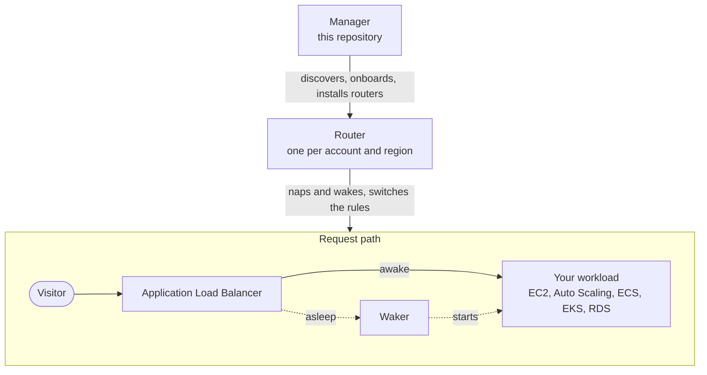

<div align="center">

<a href="https://dormeto.com"></a>

# Dormeto manager

**Find, onboard and operate idle web workloads across your AWS organization, from one dashboard.**

[Website](https://dormeto.com) · [Get started](https://dormeto.com/get-started.html) · [Product](https://dormeto.com/product.html) · [Security](https://dormeto.com/security.html) · [Releases](https://dormeto.com/releases.html) · [Router](https://github.com/Dormeto/router)

[](https://dormeto.com/releases.html)
[](https://github.com/Dormeto/router)


</div>

Dormeto stops the workloads behind your Application Load Balancer when nobody uses them, and starts them again when a
real visitor arrives. Awake, traffic goes straight to your application: Dormeto is out of the request path.

This repository is the **manager**, which runs in one account of your organization: a dashboard, an API, and the
discovery and operations it runs in your other accounts through roles you create. It finds what could nap in every
account and region, onboards it in a click, and installs and upgrades the [routers](https://github.com/Dormeto/router)
that nap and wake each workload.

<picture>
  <source media="(prefers-color-scheme: dark)" srcset="https://dormeto.com/img/overview-dark.webp">
  
</picture>

## How it works



1. **Detect idle.** The router watches the request count of each workload on your load balancer. After an idle window
   (15 minutes by default), the workload is due for a nap.
2. **Nap.** The load balancer's rules switch to a small Lambda function, the waker, and the backends stop. A request
   during the switch cancels the nap, so nobody is caught half-way.
3. **Wake just in time.** The first real request starts the backends. The visitor is held while they start and
   redirected as soon as the application answers, or sees a page that reloads by itself. The rules then switch back to
   your application.

## From discovery to the first nap

<table>
<tr>
<td width="50%" valign="top">
<picture>
  <source media="(prefers-color-scheme: dark)" srcset="https://dormeto.com/img/discovery-dark.webp">
  
</picture>
<p><b>Finds what could nap.</b> Discovery reads the load balancer rules of every account and region of your
organization with a read-only role, and shows each candidate with its idle share over the last 7 days.</p>
</td>
<td width="50%" valign="top">
<picture>
  <source media="(prefers-color-scheme: dark)" srcset="https://dormeto.com/img/workload-dark.webp">
  
</picture>
<p><b>Onboards in one click, after a preview.</b> The preview shows what would change and checks the load balancer's
quotas. Your rules and your infrastructure as code stay untouched.</p>
</td>
</tr>
<tr>
<td width="50%" valign="top">
<picture>
  <source media="(prefers-color-scheme: dark)" srcset="https://dormeto.com/img/routers-dark.webp">
  
</picture>
<p><b>Installs and upgrades the routers.</b> By AWS API calls, through the command role you created. Each router
reports its health, and failed wakes say why.</p>
</td>
<td width="50%" valign="top">
<picture>
  <source media="(prefers-color-scheme: dark)" srcset="https://dormeto.com/img/operations-dark.webp">
  
</picture>
<p><b>Every change, step by step.</b> Onboardings, offboardings and router upgrades run as operations in the target
account, one change per load balancer at a time.</p>
</td>
</tr>
</table>

## Highlights

- **Only real visitors wake it.** Bots, crawlers, monitors and internet scanners get a waiting page, never a wake. In
  browser wake mode, only a page that runs its script wakes the workload.
- **EC2, Auto Scaling, ECS, EKS, RDS.** Instances stop; Auto Scaling groups, ECS services and Kubernetes Deployments
  scale to zero; databases stop after their application and start before it.
- **Savings you can check.** AWS list prices of what each nap stopped, Spot capacity at Spot prices, less the discounts
  you set, net of Dormeto's own cost. Each workload's idle window card replays its last 14 days of requests to choose
  the window.
- **Alerts where you work.** Failed wakes and router health reach your email and chat channels (Amazon Q Developer in
  Slack or Microsoft Teams) within 5 minutes.
- **Runs in your account.** The manager and the routers run in your AWS accounts, through least-privilege roles you
  create. Nothing is sent to Dormeto, and there is no CloudFormation anywhere.
- **People and audit.** Viewers, operators and administrators, Amazon Cognito sign-in with MFA, and every change
  recorded with its author, its target and its result.

## Measured, not promised

| 67 s | 30 to 50 s | 0 |
|:---:|:---:|:---:|
| for discovery to process a synthetic organization of 1,002 accounts and 17,033 account-regions | to wake an EC2 instance, an Auto Scaling group or a Fargate service | requests through Dormeto once a workload is awake |

Figures from our test environment in eu-west-1 and eu-west-3, and how each was measured: [Scale](https://dormeto.com/scale.html).

## Get started

**Estimate first.** What Dormeto would save on an AWS account or organization, before anything is installed, from a
laptop with read access, with the [Dormeto CLI](https://github.com/Dormeto/cli):

```bash
brew install dormeto/tap/dormeto        # or: npx @dormeto/cli, or: curl -fsSL https://dormeto.com/install.sh | sh
dormeto estimate --profile <your-aws-profile> --uptime
```

It writes a summary and a Markdown and JSON report; the options, phases, reports and permissions are in the
[CLI's documentation](https://github.com/Dormeto/cli).

**Install** the manager in one account with Terraform, from a versioned release:

```hcl
module "dormeto" {
  source          = "https://releases.dormeto.com/manager/0.10.0/terraform-aws-dormeto-0.10.0.zip//modules/manager"
  env             = "prod"
  organization_id = "o-exampleorgid"
  admin_emails    = ["you@example.com"]
}

output "dashboard_url" {
  value = module.dormeto.dashboard_url
}
```

```bash
terraform init
terraform plan -out=dormeto.tfplan
terraform apply dormeto.tfplan
```

The other accounts get two roles, from a Terraform module or an AWS CLI script
([Organization access](https://dormeto.com/organization-access.html)); the manager then installs the routers itself.
The whole guide: [Get started](https://dormeto.com/get-started.html). Every input:
[Configuration](https://dormeto.com/configuration.html) and
[the module's README](infra/terraform/modules/manager/README.md).

## Documentation

| Topic | What it covers |
|---|---|
| [Operations, alerts and history](docs/operations.md) | Onboarding and router operations, health alerts, IP lists, MFA, failed wakes, state history |
| [Savings](docs/savings.md) | What is priced, Spot, discounts, the daily job, the idle window advisor |
| [Savings estimate](https://github.com/Dormeto/cli) | The Dormeto CLI's `dormeto estimate`: accounts, filters, uptime, companion databases, cache, permissions |
| [Organization access](docs/organization-access.md) | The discovery and command roles, the `access` and `organization` modules |
| [Development](docs/development.md) | Build, test, a development environment, screenshots, releases |

## Repository layout

| Path | Content |
|---|---|
| `packages/api` | API Lambda (TypeScript, HTTP API payload 2.0): identity and roles, routers, workloads, actions, discovery, users, audit |
| `packages/dashboard` | Vue 3 + Vuetify 4 single-page application, sign-in with the Cognito managed login (PKCE) |
| `packages/discovery` | Discovery: the organization's accounts and regions, the load balancer rules that could nap, the organization access checks |
| `packages/operations` | Operations, one step at a time in Step Functions: onboarding, offboarding, router installs and upgrades |
| `packages/fleet` | The routers' events: workload states, history, savings and prices, the idle window replay |
| `infra/terraform/modules/manager` | The manager module (what a release installs): DynamoDB, the Lambdas, HTTP API + JWT authorizer, Step Functions, EventBridge, Cognito, CloudFront + S3, optional custom domain and SES |
| `infra/terraform/modules/access`, `organization` | The organization roles of an account, the delegation policy of the management account |
| `infra/terraform/platform` | Dev: the manager module with the local build, its certificate and DNS |
| `scripts` | `smoke.mjs` (API checks as the smoke user), `screenshots.mjs` (signed-in dashboard screenshots), `release/` (the module's artifacts from the builds, a release and its publication) |

The manager never reads the router tables or the workload resources itself: each router controller answers the `list`,
`status`, `force-wake`, `nap` and `discover` actions.

```bash
npm ci
npm test && npm run typecheck
```

---

<div align="center">
<sub>Dormeto means “nap” in Esperanto · <a href="https://dormeto.com">dormeto.com</a> · <a href="mailto:contact@dormeto.com">contact@dormeto.com</a></sub>
</div>
