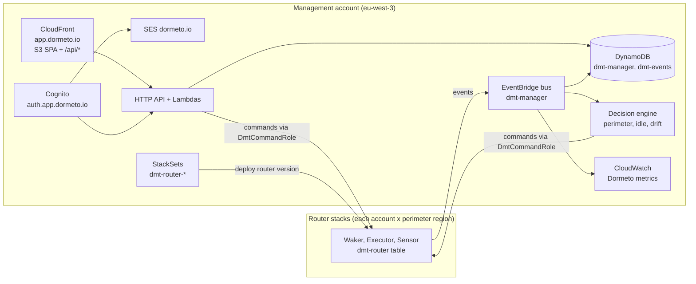
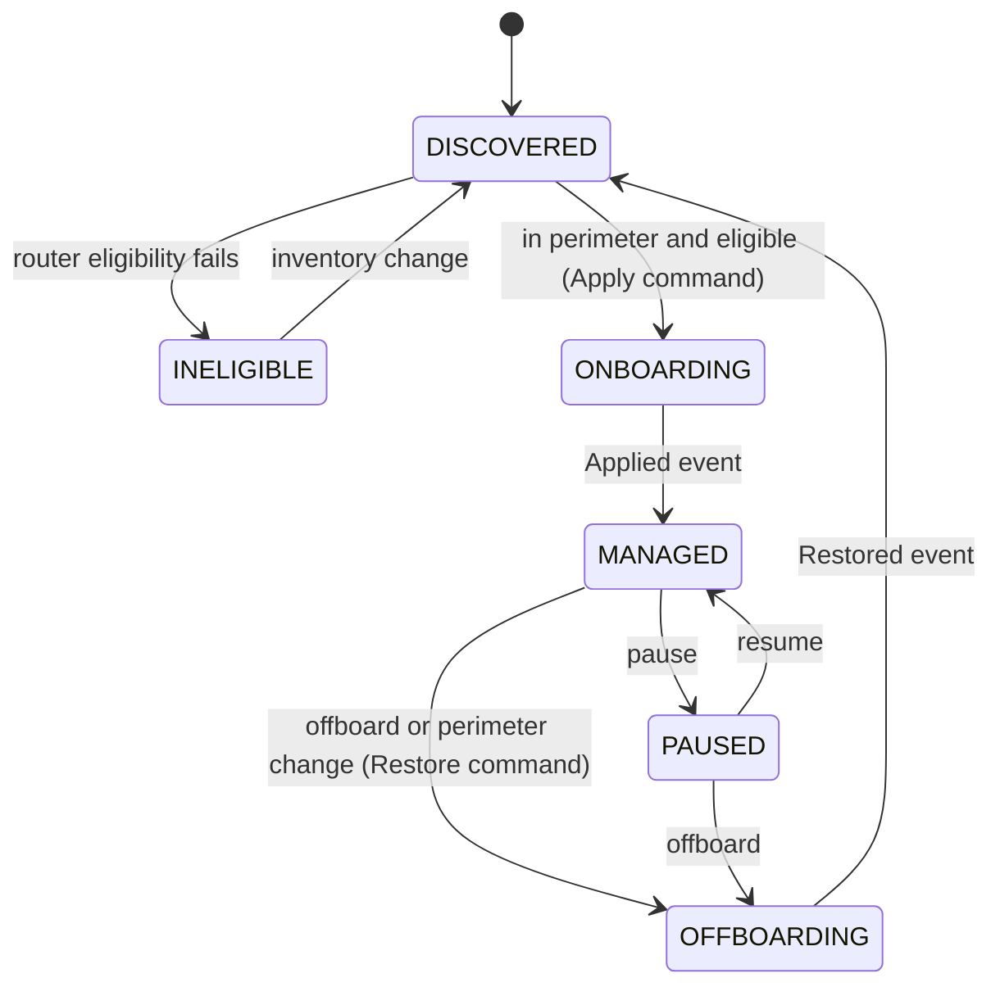
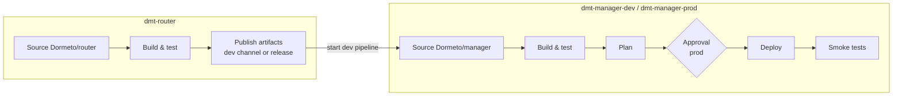

# Dormeto Manager — Implementation Plan

> Status: draft v0.3 — 2026-09-27 (split from the Kloudy Awaker plan v0.2)
> Repository: `Dormeto/manager` — the **management plane**: configuration, perimeter, decisions, API, dashboard,
> deployment of the routers, CI/CD. Companion repository: `Dormeto/router` — the **data plane** (see its
> `docs/PLAN.md`).
> Stack: **Terraform**, TypeScript on the **Node.js Lambda runtime** (`nodejs24.x`), **Vue 3 + Vuetify 4 (latest)**,
> fully serverless, **no VPC**, delivered by **CodePipeline + CodeBuild**.
> Default AWS profile for Terraform, AWS CLI and manual operations: **`kloudy-website`** (the account that also owns
> the `dormeto.*` domains).
> Naming: product **Dormeto**, resource prefix `dmt`, tag prefix `dormeto`, metric namespace `Dormeto`.

---

## 1. Purpose

Dormeto detects idle web workloads, puts them to sleep (routes diverted to a lightweight Waker, backends stopped),
and wakes them just-in-time on the next request. While awake, the Waker is not in the data path.

The **manager** is the brain:

- **deployment** of the management plane and of the routers (StackSets) into the perimeter;
- **perimeter** (accounts, OUs, account tags, regions) and **auto-onboarding** by resource tags;
- **decisions**: onboarding, idle-driven sleep, schedules, pause, drift remediation;
- **commands** to the routers, and ingestion of their **events**;
- **API** and **dashboard** (metrics, managed resources, configuration, events, errors, drift, remediation);
- **identity** (Cognito), **email** (SES), **domains** (Route 53), **CI/CD** for both repositories.

The router holds the cloud-specific code and executes. The manager stays mostly cloud-agnostic, which makes the future
SaaS mode and GCP/Azure/S3NS support simpler.

### Principles

1. Waking never depends on the manager. Sleep, configuration and remediation decisions do.
2. Desired configuration is authoritative in the manager. Runtime state is authoritative in the routers and replicated
   here through events.
3. Tenant-ready data model: every key is prefixed by `tenantId` (`default` in regional and organization modes).
4. Every decision records its reason (why a resource is or isn't managed, why it slept, why a remediation happened).

---

## 2. Roadmap

| Phase | Content | Mode |
|---|---|---|
| **P0** | Foundations: Terraform bootstrap, pipelines, domains, core domain logic, router spikes (router repo) | — |
| **P1** | MVP ALB + ECS: perimeter (resource tags), idle decisions, commands, events, drift records, API + CLI | Regional |
| **P2** | Dashboard (Vuetify), Cognito, SES, custom domains, WAF/geo options, remediation UI | Regional |
| **P3** | Organization mode: delegated admin, service-managed StackSets, account/OU/account-tag perimeter | Organization |
| **P4** | EC2 and ASG backends (router), manager UI and policies for them | Both |
| **P5** | RDS/Aurora companions (router), dependency ordering in workload config | Both |
| P6+ | SaaS mode, then GCP + S3NS, then Azure | — |

---

## 3. Architecture



### 3.1 Components

| Component | Implementation |
|---|---|
| Event ingestion | EventBridge bus `dmt-manager` (resource policy: own account, or organization with `aws:PrincipalOrgID`) → Lambda → `dmt-events`, runtime state replica in `dmt-manager`, `Dormeto` metrics |
| Perimeter engine | Evaluates accounts (Organizations), regions and resource tag rules on router inventory deltas. Emits `Apply`/`Restore` commands |
| Idle decision engine | Consumes `AlarmStateChanged`, applies policies (minimum awake time, keep-awake schedules, pause, circuit state, wake budget), sends `Sleep` |
| Reconciler | Every 5 min: missed events (alarm in ALARM while AWAKE), stale router digests, stuck transitions |
| Drift manager | Stores `DriftDetected` records, applies auto-remediation policies, exposes reapply/adopt/ignore |
| Command dispatcher | Assumes `DmtCommandRole` in the target account and region (credential cache), writes config items, starts Executor executions, retries, records `CommandFailed` |
| API | API Gateway HTTP API + Lambda handlers, Cognito JWT authorizer, served behind CloudFront `/api/*` |
| Dashboard | Vue 3 + Vuetify 4 SPA on S3 + CloudFront |
| Router deployment | StackSets `dmt-router-account` and `dmt-router-region` at the pinned router version |

### 3.2 Repository layout

```
manager/
├── packages/
│   ├── domain/            # cloud-agnostic: perimeter evaluation, policy resolution with provenance, lifecycle, drift records
│   ├── api/               # HTTP API handlers
│   ├── engine/            # event ingestion, perimeter, idle decisions, reconciler, drift manager, command dispatcher
│   ├── cognito-triggers/  # pre sign-up (email domain allow-list), post confirmation (default group)
│   ├── dashboard/         # Vue 3 + Vuetify 4 SPA
│   └── cli/               # dormeto CLI (P1 operator interface)
├── infra/
│   ├── terraform/
│   │   ├── bootstrap/     # manual once: state bucket, CodeConnection, pipelines (router + manager), CodeBuild, roles
│   │   ├── domains/       # Route 53 records shared by all environments (defensive records for dormeto.*)
│   │   ├── foundation/    # per env: artifact buckets (+ regional StackSet), KMS, StackSet roles, org delegation
│   │   ├── platform/      # per env: management plane, Cognito, SES, ACM, CloudFront, router StackSets
│   │   ├── modules/       # cognito, ses-domain, static-site, http-api, lambda, stackset, ...
│   │   └── env/           # dev.tfvars, prod.tfvars, bootstrap.tfvars, backend configs
│   ├── cloudformation/
│   │   └── artifacts-regional.yaml   # regional artifact bucket in the management account
│   ├── buildspec/         # build.yml, plan.yml, deploy.yml, smoke.yml
│   └── scripts/           # org-prereqs.sh, helpers
├── Makefile               # AWS_PROFILE ?= kloudy-website
└── docs/
```

The contracts (commands, events, router table items, configuration schemas) come from `@dormeto/contracts`, published
by the router repository to GitHub Packages and pinned here.

---

## 4. Deployment modes

The code is the same in every mode. A mode only configures the perimeter source (which accounts) and how the routers are deployed.

### 4.1 Regional mode (P1)

- One AWS account. `management_region = "eu-west-3"`. `perimeter_regions` defaults to `[management_region]`.
- The router is deployed to each perimeter region by a **self-managed StackSet** targeting the same account (Terraform
  creates the StackSet administration and execution roles). Adding a region is a tfvars change.
- Lambda code must be in an S3 bucket in the function's region. The `artifacts-regional` StackSet creates
  `dmt-artifacts-<account>-<region>` in every perimeter region, and the deploy stage copies the router version into them.
- Account rules don't apply here (single account). Resource tag rules apply.

### 4.2 Organization mode (P3)

- Management plane in a **delegated administrator** account, not the organization management account.
- One-time prerequisites, scripted in `infra/scripts/org-prereqs.sh` and run with the **organization management account**
  credentials:
  - enable StackSets trusted access and register the delegated administrator;
  - attach an **Organizations resource-based delegation policy** allowing read-only calls from the management account
    (`ListAccounts`, `ListParents`, `ListChildren`, `ListOrganizationalUnitsForParent`, `ListTagsForResource`,
    `DescribeAccount`, `DescribeOrganization`);
  - forward organization events (account created, moved, account tags changed) to the `dmt-manager` bus.
- Routers are deployed by **service-managed StackSets** (`permission_model = "SERVICE_MANAGED"`, `call_as =
  "DELEGATED_ADMIN"`) with auto-deployment on the included OUs.
  - Excluded account IDs use `AccountFilterType = DIFFERENCE`.
  - Tag-based account filters are evaluated by the manager, because StackSets can't target by tag. Router stacks in
    out-of-perimeter accounts stay **dormant** (no workload is activated there).
- Regional artifact buckets grant `s3:GetObject` to `aws:PrincipalOrgID`.
- The organization management account is out of scope by default.

### 4.3 SaaS mode (P6)

Same manager, multi-tenant: onboarding through a CloudFormation quick-create link (router account + region stacks),
`sts:ExternalId` on `DmtCommandRole`, tenant claim in tokens, per-tenant bus rules. No router change needed.

---

## 5. Perimeter and auto-onboarding

### 5.1 Evaluation order

```
1. Account perimeter  (org mode)  include/exclude by account ID, OU ID (recursive), account tags
2. Region perimeter               perimeter_regions
3. Resource rules                 tag mode (include | exclude) + exclude tags, on router inventory
4. Eligibility                    reported by the router (reason codes)
5. Manual override                dashboard/API onboard / offboard / pause, always wins
```

**Exclude wins over include at the same level.** Every decision stores its reason, for example
`excluded: account tag env=prod`.

### 5.2 Accounts (organization mode)

```yaml
perimeter:
  accounts:
    include:                        # empty include = every account of the organization
      accountIds: []
      ouIds: [ou-ab12-devtest]      # recursive by default
      accountTags: { env: [dev, test, staging] }
    exclude:
      accountIds: ["111122223333"]
      ouIds: [ou-ab12-security]
      accountTags: { dormeto: [disabled] }
  ouRecursive: true
  regions: [eu-west-3, eu-west-1]
```

`inScope(account) = (include is empty OR matches any include criterion) AND NOT matches any exclude criterion`. Account
tags come from Organizations. Re-evaluated hourly, on organization events and on configuration change.

### 5.3 Resource tag mode

```yaml
perimeter:
  resources:
    mode: include                      # default: opt-in by tag. exclude = every eligible resource except excluded ones
    includeTag: { key: "dormeto", values: ["enabled", "true"] }
    excludeTag: { key: "dormeto", values: ["disabled", "false"] }
```

- Evaluated on the backend (ECS service), inherited from the ECS cluster, and blocked by an exclude tag on the ALB or rule.
- Precedence: manual override > service tag > cluster tag > `mode` default.

Per-resource overrides:

| Tag | Example | Effect |
|---|---|---|
| `dormeto` | `enabled` / `disabled` | Include / exclude |
| `dormeto:workload` | `billing-portal` | Group services (and companions) into one workload |
| `dormeto:idle-minutes` | `45` | Idle window |
| `dormeto:wait-seconds` | `0` | Waker hold before the waiter page |
| `dormeto:page` | `brand-a` | Waiter page template |
| `dormeto:policy` | `business-hours` | Named policy |

Invalid values are reported as `ConfigError`, never silently ignored.

### 5.4 Policies

Resolved with provenance (default → policy → tag → manual override) and pushed to the router in `PutWorkloadConfig`:

| Setting | Default |
|---|---|
| Idle signal | ALB `RequestCount` on the real target groups, threshold 0, `idleMinutes` 30. Custom metric or metric-math expression optional |
| `minAwakeMinutes` | 15 |
| Waker: `waitSeconds`, `readyResponse`, page, `maxHolders`, `wakeFilter`, `wakeTimeoutSeconds`, `maxWakesPerHour` | See router plan §5.1 (20 s, redirect, default page, 50, bots/health/HEAD, 600 s, 12) |
| Drift remediation | `alert`, with `fail-open` safety (executed locally by the router) |
| Schedules (later) | Keep-awake and force-sleep windows (cron + timezone) |

---

## 6. Workload lifecycle (manager view)



While `MANAGED`, the runtime state (`AWAKE`, `SLEEPING`, `ASLEEP`, `WAKING`, `FAILED`) is replicated from router events.
Concurrency rules on the manager side:
- every mutable item carries a `version`; API writes use `If-Match` → DynamoDB condition → HTTP 409 on conflict;
- inventory ingestion never overwrites user-owned fields;
- commands are idempotent (the router ignores duplicates by `stateVersion` and execution names);
- dispatch is rate-limited per account and region (token bucket).

---

## 7. Data model

### 7.1 `dmt-manager` (single table)

| PK | SK | Entity |
|---|---|---|
| `T#<tenant>` | `SETTINGS` | Mode, regions, tag keys, defaults, router version |
| `T#<tenant>` | `PERIMETER` | Account/OU/tag include/exclude, resource tag mode |
| `T#<tenant>` | `POLICY#<id>` | Policies |
| `T#<tenant>` | `TEMPLATE#<id>` | Page template metadata (body in S3) |
| `T#<tenant>#A#<account>` | `ACCOUNT` | Account metadata, tags, OU path, perimeter decision + reason, router stack status |
| `T#<tenant>#A#<account>#R#<region>` | `RES#<arn>` | Inventory from the router, eligibility, tag decision + reason |
| `T#<tenant>` | `WL#<id>` | Workload: members, bindings, lifecycle, runtime replica, effective config, baseline copy ref, version |
| `T#<tenant>#WL#<id>` | `DRIFT#<id>` | Drift record: status `open` / `remediated` / `adopted` / `ignored` |
| `T#<tenant>` | `AUDIT#<ts>#<id>` | API/dashboard audit log |

GSIs: workloads by lifecycle/runtime state, resources by account, drift by status.

### 7.2 `dmt-events`

`PK = T#<tenant>#WL#<id>`, `SK = <ts>#<eventId>`, TTL `events_ttl_days` (default 90), plus a GSI by type/severity for the Events and Errors views.

### 7.3 Metrics (`Dormeto` namespace)

`WakeDurationSeconds` (p50/p95), `WakeCount`, `WakeFailures`, `HeldRequests`, `WaiterPagesServed`, `AsleepMinutes`,
`EstimatedSavingsUSD` (asleep time × Fargate vCPU/memory price from the Pricing API).

---

## 8. API

API Gateway **HTTP API**, Cognito JWT authorizer, exposed to browsers only through CloudFront `/api/*` (caching disabled,
all methods, `Authorization` forwarded). The WAF WebACL and country allow-list therefore apply to the API too.
Hardening option (D8): disable the default `execute-api` endpoint.

```
GET  /health (no auth)
GET  /settings                PUT /settings
GET  /perimeter               PUT /perimeter         POST /perimeter/preview
GET  /accounts                GET /accounts/{id}
GET  /resources?account&region&eligible
GET  /workloads               GET /workloads/{id}
POST /workloads/{id}:onboard | :offboard | :sleep | :wake | :pause | :resume
PUT  /workloads/{id}/overrides
GET  /policies                POST/PUT/DELETE /policies/{id}
GET  /templates               POST/PUT/DELETE /templates/{id}      POST /templates/{id}:preview
GET  /events?workload&type&severity&from&to
GET  /drift?status            POST /drift/{id}:reapply | :adopt | :ignore
GET  /metrics?workload&metric&from&to      (GetMetricData, via DmtMetricsReadRole for workload metrics)
GET  /users                   PUT /users/{id}/group   POST /users/{id}:disable     (admin)
POST /discovery:run
```

RBAC from Cognito groups: `dmt-admin`, `dmt-operator` (sleep/wake/pause/remediate), `dmt-viewer` (read-only).
Every mutating call is audited.

---

## 9. Management application: edge, Cognito, email, dashboard (P2)

### 9.1 Domains

- The `dormeto.com`, `.io`, `.fr`, `.ai`, `.net`, `.dev` and `.app` domains are registered with Route 53 in the
  `kloudy-website` account, with public hosted zones.
- **Product domain: `dormeto.io`** (D5):

| Environment | Dashboard | Cognito managed login | Email sender |
|---|---|---|---|
| `prod` | `app.dormeto.io` | `auth.app.dormeto.io` | `no-reply@dormeto.io` |
| `dev` | `app.dev.dormeto.io` | `auth.app.dev.dormeto.io` | `no-reply@dev.dormeto.io` |

- Cognito custom domains require the **parent domain to resolve** (A record). Putting the auth domain under the
  dashboard hostname (`auth.app...`) guarantees this, because `app...` is the CloudFront alias record.
- The `domains` root module adds defensive records on every non-sending `dormeto.*` domain: `v=spf1 -all`, DMARC
  `p=reject`, null MX, CAA restricted to Amazon. `dormeto.com` is kept for a future marketing site (out of scope).

### 9.2 Edge (CloudFront)

- S3 (private, OAC) for the SPA. Default behavior → S3, with SPA fallback to `index.html` by a CloudFront Function (not
  custom error responses, so API errors stay intact). `/api/*` → HTTP API.
- Response headers policy: CSP (self + Cognito domain), HSTS, `X-Content-Type-Options`, `Referrer-Policy`,
  `frame-ancestors 'none'`.
- `/config.json` (API path, Cognito domain, client ID, feature flags) is generated from Terraform outputs at deploy time, so
  there is no per-environment build.

| Variable | Default | Behavior |
|---|---|---|
| `dashboard_domain` | `app.dormeto.io` (prod) / `app.dev.dormeto.io` (dev); `null` → `*.cloudfront.net` | ACM certificate in **us-east-1**, DNS validation and alias in Route 53 |
| `route53_zone_name` | `dormeto.io` | Zone where Terraform creates records. `null` → records printed as outputs |
| `cloudfront_web_acl_arn` | `null` → **no WAF** | Existing WebACL (scope `CLOUDFRONT`, us-east-1) |
| `allowed_countries` | `[]` → **no geo restriction** | ISO 3166-1 alpha-2 allow-list (CloudFront geo restriction) |
| `price_class` | `PriceClass_100` | |

### 9.3 Cognito

| Variable / setting | Default | Behavior |
|---|---|---|
| Directory | **Cognito internal user directory** | Username = email. External SAML/OIDC IdPs optional later (`identity_providers`) |
| `self_signup_enabled` | `true` | Self-registration on managed login |
| `signup_allowed_email_domains` | `["kloudy.io"]` | **Pre sign-up trigger** rejects other domains (case-insensitive exact match, subdomains only if listed) |
| Verification | **Email code** | `auto_verified_attributes = ["email"]`, account unusable until confirmed |
| `auth_domain` | `auth.<dashboard_domain>`; `null` → Cognito prefix domain | Managed login custom domain, ACM in **us-east-1** |
| `cognito_web_acl_arn` | `null` → **no WAF** | Existing **REGIONAL** WebACL in eu-west-3 associated with the user pool. CloudFront geo restriction does not cover the Cognito domain |
| `admin_emails` | `[]` | Bootstrap admins (temporary password emailed), group `dmt-admin` |
| MFA | `OPTIONAL` (TOTP) | `ON` recommended for prod |

- Managed login (Essentials tier) with Dormeto branding. Authorization code + PKCE, public client, access/ID tokens 1 h,
  refresh token 12 h.
- The post confirmation trigger adds new users to `dmt-viewer`. Admins promote users from the dashboard.
- Threat protection (Plus tier) is optional and off by default.

### 9.4 Email (SES custom domain)

| Variable | Default | Behavior |
|---|---|---|
| `ses_domain` | `dormeto.io` (prod) / `dev.dormeto.io` (dev) | SES domain identity in eu-west-3 with Easy DKIM, records in Route 53 |
| `ses_mail_from_subdomain` | `mail` | Custom MAIL FROM (MX + SPF) for SPF alignment |
| `email_from` | `Dormeto <no-reply@dormeto.io>` | Cognito FROM address |
| `manage_dmarc` | `true` | DMARC record on the sending domain |
| `ses_sandbox_recipient_domains` | `= signup_allowed_email_domains` | While SES is in sandbox, each listed domain (`kloudy.io`) is also verified as an SES identity (DKIM records in its Route 53 zone), so any `@kloudy.io` address can receive mail |

- Cognito `email_configuration`: `email_sending_account = "DEVELOPER"`, `source_arn` = SES identity ARN,
  `from_email_address = email_from`.
- Verification and invitation templates (HTML + text) versioned in the repo.
- Opening sign-up beyond the verified domains requires **SES production access** (manual request, ~24 h lead time).

### 9.5 Dashboard (Vue 3 + Vuetify 4)

- Vite 8, Vue 3.5, **Vuetify 4 (latest, pinned at P0)** with `vite-plugin-vuetify`, Pinia, Vue Router with auth guards,
  `vue-echarts`, `oidc-client-ts` (generic OIDC, so Cognito can be replaced by Entra ID, Google Identity or a customer
  IdP later), light/dark theme, i18n (en, fr).
- `VDataTableServer` for inventory, events and drift, `VTimeline` for workload history, a diff viewer for drift, a
  template editor with sandboxed `iframe` preview (shared renderer from the router's `page` package, published on GitHub Packages).
- Views:
  - **Overview:** workloads by state, savings, wake p50/p95, open drift, recent errors.
  - **Workloads:** list; detail with state timeline, metrics, bindings/backends graph, effective config with provenance,
    actions, latency advisor.
  - **Inventory:** eligible / ineligible (reasons) / managed.
  - **Configuration:** mode, regions, perimeter editor with live **scope preview**, policies, page templates.
  - **Events** and **Errors.**
  - **Drift:** expected vs actual diff, reapply / adopt / ignore, history.
  - **Audit.**
  - **Users** (admin): groups, disable.

---

## 10. Router deployment

| StackSet | Target | Template | Key parameters |
|---|---|---|---|
| `dmt-artifacts-regional` | Management account, each perimeter region (self-managed) | `infra/cloudformation/artifacts-regional.yaml` | Org ID (org mode read policy) |
| `dmt-router-account` | Each in-scope account, one region | router `router-account.yaml` | Manager account ID and role ARNs |
| `dmt-router-region` | Each in-scope account × perimeter region | router `router-region.yaml` | `RouterVersion`, artifact bucket prefix, manager bus ARN, Waker reserved concurrency, Waker timeout, log retention |

- `router_version`: `dev` reads SSM `/dmt/dev/router-version` (updated by the router pipeline). `prod` pins a semver in
  `env/prod.tfvars` through a pull request.
- Operation preferences: regions in parallel, max concurrent 25% of accounts, failure tolerance 0 in prod. Terraform waits for
  the operation to finish.
- Uninstall: every workload must be restored before the router StackSets are deleted (guard in Terraform and the API).

---

## 11. Security and IAM (manager side)

| Role | Permissions |
|---|---|
| Manager Lambda roles | DynamoDB/S3/Events on `dmt-*` resources; `sts:AssumeRole` on `DmtCommandRole` and `DmtMetricsReadRole`; Cognito admin APIs on the Dormeto user pool (Users view); Organizations read (org mode, via delegation policy) |
| `DmtCodeBuildRole` | Terraform deployer scoped to `dmt-*` resources where IAM allows it, state bucket, artifact buckets, CloudFront invalidation. Every role created by Terraform must carry the **`dmt-boundary` permission boundary** (enforced on `iam:CreateRole`) |
| `dmt-manager` bus policy | `events:PutEvents` from the own account (regional) or `aws:PrincipalOrgID` (organization) |

- KMS encryption for tables and buckets, log retention 30 days by default, no request payloads in logs.
- Dashboard: no AWS credentials in the browser, every call goes through the API.

---

## 12. Delivery: Terraform, CodePipeline, CodeBuild

### 12.1 Terraform

| Root module | Applied by | Content |
|---|---|---|
| `bootstrap` | Manually, once (profile `kloudy-website`) | State bucket `dmt-tfstate-<account>-eu-west-3`, CodeConnection (GitHub), pipelines `dmt-router`, `dmt-manager-dev`, `dmt-manager-prod`, CodeBuild projects, `DmtCodeBuildRole`, `dmt-boundary`, notifications |
| `domains` | Pipeline (prod) | Defensive DNS records on the `dormeto.*` zones |
| `foundation` | Pipeline, per env | Primary artifact bucket, KMS, `dmt-artifacts-regional` StackSet, StackSet admin/execution roles (regional), org delegation resources (org mode) |
| `platform` | Pipeline, per env | DynamoDB, Lambdas, HTTP API, EventBridge, Cognito + triggers, SES, ACM, CloudFront, dashboard bucket, WAF associations, router StackSets |

- S3 backend with the **native lock file** (`use_lockfile = true`, no DynamoDB lock table). Keys: `bootstrap.tfstate`, `domains.tfstate`,
  `<env>/foundation.tfstate`, `<env>/platform.tfstate`.
- Terraform ≥ 1.15, AWS provider pinned to the latest major at P0, alias `us_east_1` (ACM, CloudFront WAF).
- `default_tags`: `dormeto:component`, `dormeto:env`, `managed-by = terraform`.
- Gates: `fmt -check`, `validate`, TFLint, Checkov, terraform-docs.

### 12.2 Pipelines (CodePipeline V2, CodeBuild without VPC, arm64)



- **`dmt-manager-*`:**
  1. **Source:** GitHub through CodeConnections. `dev` on push to `main`, `prod` on tags `v*`.
  2. **Build & test:** `npm ci`, lint, type-check, unit tests + coverage, `npm audit`, Lambda bundles, dashboard build,
     cfn-lint, Terraform gates.
  3. **Plan:** `terraform plan -out` for `foundation` and `platform` (plus `domains` in prod), with the summary exposed to the approval.
  4. **Approval:** required in prod.
  5. **Deploy:**
     - apply `foundation`;
     - copy the router version to the regional artifact buckets;
     - apply `platform`. If `foundation` changed, `platform` is re-planned, and prod needs a second approval.
     - dashboard publish: `config.json` from outputs, `s3 sync`. Hashed assets are immutable, `index.html` and `config.json`
       are `no-cache`. Then a CloudFront invalidation.
  6. **Smoke tests:** dashboard 200, `/api/health` 200, Cognito OIDC discovery, SES identity verified. In dev, an end-to-end
     sleep/wake scenario on the sample ECS workload.
- **`dmt-router`:** build/test/publish, defined here but using the router's `buildspec/` (see the router plan §12).
- CodeBuild: Terraform downloaded at the pinned version with SHA-256 check, S3 cache for providers, npm cache, role
  credentials only (`TF_VAR_aws_profile=""`), concurrency 1 per project and environment, logs retained 30 days.
- Rollback: re-run on the previous tag. Artifacts are immutable.

### 12.3 Bootstrap

```bash
export AWS_PROFILE=kloudy-website
aws sso login                          # when the SSO session has expired
cd infra/terraform/bootstrap
terraform init
terraform apply -var-file=../env/bootstrap.tfvars
terraform init -migrate-state          # move the bootstrap state into the bucket it created
```

Then, once:
- install the **AWS Connector for GitHub** app on the `Dormeto` GitHub account (repositories `router` and `manager`);
- complete the CodeConnection handshake in the console (`PENDING` → `AVAILABLE`);
- store the GitHub Packages token in Secrets Manager (`dmt/github-packages-token`).

### 12.4 Environments

- `dev`: auto-deployed from `main` in both repos, sample workload fixture, `admin_emails` = team.
- `prod`: tags + approval, router version pinned.
- Same account at first (`kloudy-website`), with `-<env>` suffixes, separate state keys, Cognito pools, domains and StackSets.

---

## 13. Operator conventions

- **`kloudy-website` is the default profile** for Terraform, the AWS CLI, scripts and manual operations. The `Makefile` uses
  `AWS_PROFILE ?= kloudy-website`. Terraform uses `var.aws_profile` (default `"kloudy-website"`, provider `profile = var.aws_profile
  == "" ? null : var.aws_profile`). The backend has no profile in code (it reads `AWS_PROFILE`). CodeBuild uses role credentials.
- Organization prerequisites need the organization management account credentials, not `kloudy-website`.
- Make targets: `bootstrap`, `plan ENV=`, `apply ENV=` (break-glass, the pipeline is the normal path), `test`, `lint`,
  `dashboard-dev ENV=` (local Vite against the env API).

### Main `platform` variables

| Variable | Default |
|---|---|
| `env` | required |
| `aws_profile` | `kloudy-website` |
| `management_region` | `eu-west-3` |
| `deployment_mode` | `regional` |
| `perimeter_regions` | `[management_region]` |
| `router_version` | SSM (dev) / pinned (prod) |
| `dashboard_domain` / `auth_domain` | `app[.dev].dormeto.io` / `auth.<dashboard_domain>` |
| `route53_zone_name` | `dormeto.io` |
| `cloudfront_web_acl_arn` / `cognito_web_acl_arn` | `null` (no WAF) |
| `allowed_countries` | `[]` (no geo restriction) |
| `self_signup_enabled` | `true` |
| `signup_allowed_email_domains` | `["kloudy.io"]` |
| `ses_domain` / `email_from` | `dormeto.io` / `Dormeto <no-reply@dormeto.io>` |
| `admin_emails` | `[]` |
| `waker_reserved_concurrency` | `100` |
| `log_retention_days` / `events_ttl_days` | `30` / `90` |

---

## 14. Multi-cloud readiness (manager side)

- `packages/domain` has no cloud SDK dependency: perimeter evaluation works on neutral terms (`scopeUnit` = account /
  project / subscription, `folder` = OU / folder / management group, `labels` = tags / labels).
- Cloud-specific pieces in the manager are limited to: perimeter source (Organizations; later Resource Manager, Management
  Groups), command transport (assume role; later service account impersonation, managed identity) and its own hosting.
- The dashboard uses generic OIDC, so S3NS can use a customer or sovereign IdP.

---

## 15. Tests

- **Unit:** perimeter evaluation (include/exclude precedence, OU recursion, account tags), policy provenance, lifecycle,
  drift record transitions (90%+ on `domain`).
- **Contract:** consumer tests against the pinned `@dormeto/contracts`.
- **API:** handler tests with DynamoDB Local, RBAC matrix.
- **Dashboard:** component tests (Vitest + Vue Test Utils), Playwright end-to-end against `dev`, accessibility checks (WCAG AA).
- **Infrastructure:** `terraform validate`, TFLint, Checkov. Plan snapshot tests on the modules.
- **End-to-end (dev):** perimeter change → onboarding → idle → sleep → request → wake → offboarding. Organization test (P3): account
  created in an included OU is onboarded automatically; moved to an excluded OU, it is restored.

---

## 16. Phases (manager deliverables)

| Phase | Manager deliverables | Exit criteria |
|---|---|---|
| **P0** | Workspaces, `bootstrap` applied, 3 pipelines green on empty stacks, `domains` module, `domain` package with tests | Pipelines green, ADRs written |
| **P1** | `foundation` + `platform` (regional): tables, bus, engine (perimeter, idle decisions, reconciler, drift manager, dispatcher), API, CLI, router StackSets | End-to-end on the sample workload in dev, with the router P1 exit criteria met |
| **P2** | Cognito (self sign-up `kloudy.io`, email code), SES `dormeto.io`, custom domains, WAF/geo options, dashboard (all views), remediation UI, savings | Every CLI action available in the UI with RBAC; WCAG AA |
| **P3** | Organization mode: prerequisites script, service-managed StackSets, account/OU/account-tag perimeter, organization events | Auto-onboarding in a new account; offboarding on exclusion |
| **P4** | EC2/ASG policies and UI | Same matrix as P1 |
| **P5** | Companion and dependency configuration, slow-wake UX settings | App + database workload managed end-to-end |
| P6+ | SaaS mode, then GCP/S3NS and Azure perimeter sources | — |

---

## 17. Decisions

| # | Decision | Status |
|---|---|---|
| D1 | Product name **Dormeto**; GitHub `Dormeto`; domains `.com .io .fr .ai .net .dev .app` | Decided |
| D2 | TypeScript, `nodejs24.x`, Vue 3 + Vuetify 4 | Decided |
| D3 | Terraform; CloudFormation only for StackSet-deployed stacks | Decided |
| D4 | GitHub via CodeConnections, CodePipeline + CodeBuild, no VPC | Decided |
| D5 | Product domain `dormeto.io` (app/auth/mail); `dormeto.com` kept for marketing | Proposed |
| D6 | Management region `eu-west-3`; Route 53 zones in the `kloudy-website` account | Decided |
| D7 | Agent model: discovery and drift sensing in the router | Proposed (router R1) |
| D8 | API hardening beyond JWT (disable `execute-api`, custom API domain) | Later |
| D9 | `dev` and `prod` in the same account at first | Proposed |
| D10 | Organization management account out of scope | Proposed |

## 18. Risks

| Risk | Mitigation |
|---|---|
| Customer IaC drift on routing | Router fail-open wake, drift UI, cooperative Terraform module |
| SES sandbox blocks sign-up for other domains | Verified recipient domains; production access requested before opening sign-up |
| Cognito custom domain needs its parent to resolve | Auth domain under the dashboard hostname |
| StackSet rollout failure in many accounts | Failure tolerance 0 in prod, staged rollout (25%), router alias switches only on success |
| Pipeline privilege escalation | `dmt-boundary` permission boundary enforced on role creation |
| Manager outage | Wake path is router-only. Break-glass restore CLI in the router repo |
